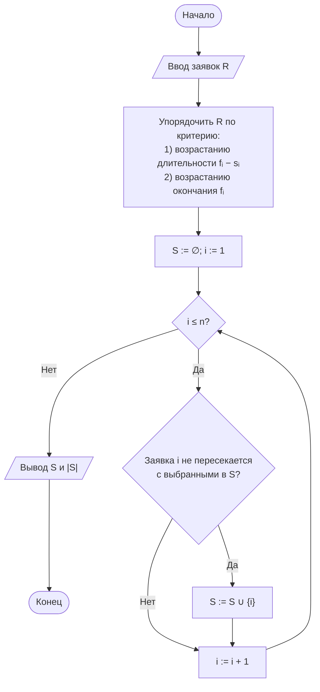

<div align="center">

**МИНИСТЕРСТВО НАУКИ И ВЫСШЕГО ОБРАЗОВАНИЯ РОССИЙСКОЙ ФЕДЕРАЦИИ**

*(полное наименование образовательной организации)*

Кафедра ____________________

# ОТЧЁТ
## по лабораторной работе № 8
### «Жадные алгоритмы и экспериментальная оценка качества приближённых решений»

**Дисциплина:** Теория алгоритмов
**Направление подготовки:** 38.03.05 «Бизнес-информатика»
**Вариант:** 7

&nbsp;

Выполнила: студентка группы БИ 2-3 Иванюшкина Дарья Андреевна

Проверил: ______________________ (ФИО преподавателя)

&nbsp;

Москва, 2026

</div>

---

## 1. Цель работы и задание варианта

**Цель работы:** изучить жадную стратегию построения алгоритмов, установить условия, при которых она приводит к оптимальному решению, и экспериментально оценить отклонение жадного решения от оптимального.

**Задание варианта 7** (табл. 1 методических указаний):

| Параметр | Значение |
|---|---|
| Задача | Выбор заявок |
| Жадный критерий 1 | Минимальная длительность |
| Жадный критерий 2 | Раннее окончание |
| Размерность | 40 заявок |
| Дополнительное задание | Ж7 — прикладная задача (распределение ресурса между заявками), сопоставление жадного и точного решений, цена ошибки в денежном выражении |

**Задачи:**

1. Реализовать два жадных критерия и точное решение (динамическое программирование) как эталон.
2. На серии из 500 случайных наборов по 40 заявок вычислить среднее и максимальное отклонение жадных решений от оптимума и долю наборов с точным совпадением.
3. Разобрать вручную контрпример, на котором жадный алгоритм ошибается.
4. Сравнить время работы жадного и точного алгоритмов при росте числа заявок.
5. Выполнить задание Ж7.

**Принятые параметры.** Начало заявки — случайное целое от 0 до 100, длительность — случайное целое от 2 до 25; заявки считаются пересекающимися, если их интервалы имеют общую часть (конец одной и начало другой, совпадающие по времени, пересечением не считаются). Генератор с фиксированным `seed = 2024`.

---

## 2. Описание задачи, жадных критериев и точного алгоритма

### 2.1. Задача о выборе заявок

Дано $n$ заявок на использование одного ресурса (зала, станка, оборудования); заявка $i$ задаётся интервалом $[s_i, f_i)$. Две заявки совместимы, если их интервалы не пересекаются. Требуется выбрать **максимальное число** попарно совместимых заявок.

### 2.2. Жадные критерии

**Критерий 1 — минимальная длительность.** Заявки упорядочиваются по возрастанию $f_i - s_i$; просматриваются по очереди, и заявка включается в решение, если она не пересекается ни с одной из уже выбранных. Идея: короткие заявки «занимают меньше времени», значит, их можно уместить больше. **Трудоёмкость** $\Theta(n \log n + nk)$, где $k$ — число выбранных заявок.

**Критерий 2 — раннее окончание.** Заявки упорядочиваются по возрастанию $f_i$; заявка включается, если её начало не раньше окончания последней выбранной. Идея: заканчиваем как можно раньше — остаётся больше времени для остальных заявок. **Трудоёмкость** $\Theta(n \log n)$ (сортировка).

**Оптимальность критерия 2** (доказательство методом замены). Пусть $a$ — заявка, заканчивающаяся раньше всех. Возьмём любое оптимальное решение $O$ и в нём заявку $b$ с наименьшим окончанием. Заменим $b$ на $a$: так как $f_a \le f_b$, новая заявка не пересекается с остальными заявками решения $O$, а число заявок не изменилось. Значит, существует оптимальное решение, содержащее $a$ (свойство жадного выбора). После выбора $a$ остаётся подзадача того же вида — выбор среди заявок, начинающихся не раньше $f_a$ (оптимальная подструктура). По индукции жадный алгоритм с критерием 2 даёт точный оптимум.

**Критерий 1 не оптимален.** Короткая заявка может «стоять посередине» и пересекаться сразу с двумя длинными, из которых можно было бы взять обе (контрпример в разделе 6). Известная гарантия: жадный выбор по минимальной длительности даёт не менее половины оптимума ($\rho \ge 1/2$), так как короткая заявка может пересекаться не более чем с двумя заявками оптимального решения.

### 2.3. Точный алгоритм — динамическое программирование

Заявки сортируются по окончанию. Пусть $best[i]$ — максимальный результат среди решений, **последней** заявкой в которых является заявка $i$:

$$best[i] = w_i + \max\bigl(0,\ \max_{j < i,\ f_j \le s_i} best[j]\bigr),$$

где $w_i = 1$ при максимизации числа заявок (и $w_i$ — доход заявки в задании Ж7). Ответ — $\max_i best[i]$.

Пояснение: заявка $i$ добавляется к лучшему решению, оканчивающемуся заявкой $j$, которая заканчивается не позже начала $i$ (совместимость); если таких $j$ нет, заявка $i$ стоит первой. Оптимальная подструктура: любое оптимальное решение, обрезанное до последней заявки, остаётся оптимальным для своей подзадачи. **Трудоёмкость** $\Theta(n^2)$; бинарный поиск ближайшей совместимой заявки снижает её до $O(n \log n)$, но здесь эталон намеренно оставлен простым и независимым от жадной идеи.

---

## 3. Блок-схема жадного алгоритма



Для критерия 2 условие в ромбе упрощается: достаточно проверить $s_i \ge f_{\text{последней выбранной}}$.

---

## 4. Листинг программы

Файл `lab8_variant7.py` (Python 3.10+, PyCharm; дополнительных библиотек не требуется).

```python
"""ЛР № 8, вариант 7: выбор заявок. Критерий 1 — минимальная длительность, критерий 2 — раннее окончание.
Точный эталон — динамическое программирование. Доп. задание Ж7 — доход от заявок."""
import random
import statistics
import time


def gen(n, rng, horizon=100):                    # n заявок: (начало, конец, доход в тыс. ₽)
    reqs = []
    for _ in range(n):
        s, d = rng.randint(0, horizon), rng.randint(2, 25)
        reqs.append((s, s + d, d * rng.uniform(0.8, 1.2)))
    return reqs


def overlap(a, b):                               # пересекаются ли заявки (концы не включаются)
    return a[0] < b[1] and b[0] < a[1]


def greedy_length(reqs):                         # критерий 1: сначала самые короткие
    chosen = []
    for r in sorted(reqs, key=lambda r: r[1] - r[0]):
        if all(not overlap(r, c) for c in chosen):
            chosen.append(r)
    return chosen


def greedy_end(reqs):                            # критерий 2: сначала те, что раньше заканчиваются
    chosen, last = [], -1
    for r in sorted(reqs, key=lambda r: r[1]):
        if r[0] >= last:                         # не пересекается с последней выбранной
            chosen.append(r)
            last = r[1]
    return chosen


def exact(reqs, weighted=False):                 # точное решение ДП, Θ(n²); weighted — максимум дохода, иначе числа заявок
    rs = sorted(reqs, key=lambda r: r[1])
    best = []
    for i, r in enumerate(rs):
        w = r[2] if weighted else 1
        best.append(w + max((best[j] for j in range(i) if rs[j][1] <= r[0]), default=0))
    return max(best, default=0)


def main():
    # --- Контрпример для критерия 1 ---
    ce = [(0, 5, 5), (4, 6, 2), (5, 10, 5)]
    print("Контрпример:", [(a, b) for a, b, _ in ce])
    print("  min длительность:", [(a, b) for a, b, _ in greedy_length(ce)], "| раннее окончание:",
          [(a, b) for a, b, _ in greedy_end(ce)], "| оптимум:", exact(ce))
    # --- Серия из 500 наборов по 40 заявок ---
    rng = random.Random(2024)
    dev = {"Минимальная длительность": [], "Раннее окончание": []}
    hits = dict.fromkeys(dev, 0)
    sets = [gen(40, rng) for _ in range(500)]
    for reqs in sets:
        opt = exact(reqs)
        for name, f in (("Минимальная длительность", greedy_length), ("Раннее окончание", greedy_end)):
            got = len(f(reqs))
            dev[name].append((opt - got) / opt * 100)
            hits[name] += got == opt
    print(f"\n{'Критерий':<26}{'среднее,%':>10}{'медиана,%':>11}{'максимум,%':>12}{'совпало':>9}")
    for name, d in dev.items():
        print(f"{name:<26}{statistics.mean(d):>10.2f}{statistics.median(d):>11.2f}{max(d):>12.2f}{hits[name] / 5:>8.1f}%")
    # --- Время при росте числа заявок ---
    print(f"\n{'n':>6}{'жадный,с':>11}{'ДП,с':>9}{'отношение':>11}")
    for n in (100, 500, 1000, 2000, 5000):
        reqs = gen(n, random.Random(1), horizon=2 * n)
        t0 = time.perf_counter(); greedy_end(reqs); tg = time.perf_counter() - t0
        t0 = time.perf_counter(); exact(reqs); te = time.perf_counter() - t0
        print(f"{n:>6}{tg:>11.5f}{te:>9.4f}{te / tg:>11.0f}")
    # --- Ж7: заявки на аренду зала приносят доход; жадность по числу заявок и максимум дохода ---
    loss_e, loss_l, opt_sum = [], [], []
    for reqs in sets:
        opt = exact(reqs, weighted=True)
        opt_sum.append(opt)
        loss_e.append(opt - sum(r[2] for r in greedy_end(reqs)))
        loss_l.append(opt - sum(r[2] for r in greedy_length(reqs)))
    print(f"\nЖ7: средний максимальный доход за день {statistics.mean(opt_sum):.1f} тыс. ₽")
    for name, loss in (("раннее окончание", loss_e), ("минимальная длительность", loss_l)):
        m = statistics.mean(loss)
        print(f"  {name:<26} потеря {m:6.1f} тыс. ₽/день ({m / statistics.mean(opt_sum) * 100:.1f} %), "
              f"{m * 250 / 1000:.2f} млн ₽/год")


if __name__ == "__main__":
    main()
```

---

## 5. Результаты по серии наборов данных

Измерения выполнены в среде Linux, Python 3.13. Серия — 500 случайных наборов по 40 заявок. Отклонение: $\delta = (K_{\text{опт}} - K_{\text{жадн}}) / K_{\text{опт}} \cdot 100\,\%$, где $K$ — число выбранных заявок.

**Таблица 1. Отклонение жадных решений от оптимума (500 наборов, 40 заявок)**

| Критерий | Среднее отклонение, % | Медиана, % | Максимум, % | Доля точных совпадений |
|---|---|---|---|---|
| Минимальная длительность | 1,89 | 0,00 | 20,00 | 82,0 % |
| Раннее окончание | 0,00 | 0,00 | 0,00 | 100,0 % |

**Анализ.**

- Критерий «раннее окончание» совпал с точным оптимумом на **всех 500** наборах, что подтверждает доказанную оптимальность (раздел 2.2).
- Критерий «минимальная длительность» в 82 % наборов дал оптимум, среднее отклонение 1,89 %, максимальное наблюдаемое — 20 %. Случайные данные «редко злы»: специально подобранный пример (раздел 6) даёт 50 %.
- Результат согласуется с теоретической гарантией $\rho \ge 1/2$: наблюдаемое отклонение не превышает 50 %.

---

## 6. Разбор контрпримера вручную

Три заявки (интервалы $[s, f)$):

| Заявка | Начало | Конец | Длительность |
|---|---|---|---|
| A | 0 | 5 | 5 |
| B | 4 | 6 | 2 |
| C | 5 | 10 | 5 |

Заявка B пересекается и с A (интервалы $[0,5)$ и $[4,6)$ имеют общую часть $[4,5)$), и с C (общая часть $[5,6)$), а A и C между собой не пересекаются ($f_A = 5 = s_C$).

**Критерий 1 (минимальная длительность).**

1. Порядок по длительности: B (2), затем A (5), C (5).
2. Берём B → $S = \{B\}$.
3. A пересекается с B → пропускаем. C пересекается с B → пропускаем.
4. Результат: **1 заявка**.

**Критерий 2 (раннее окончание).**

1. Порядок по окончанию: A (5), B (6), C (10).
2. Берём A → $S = \{A\}$, последнее окончание 5.
3. B: $s_B = 4 < 5$ → пропускаем. C: $s_C = 5 \ge 5$ → берём.
4. Результат: $S = \{A, C\}$, **2 заявки**.

**Оптимум** — $\{A, C\}$, 2 заявки. Отклонение критерия 1: $(2 - 1)/2 = 50\,\%$ ($\rho = 1/2$, гарантия достигается).

**Причина ошибки.** Критерий 1 оценивает заявку только по её длине и не учитывает её положение: короткая заявка, стоящая «посередине», блокирует сразу две длинные. Критерий 2 учитывает, насколько рано освобождается ресурс, а именно это определяет, сколько заявок можно разместить дальше.

Результат программы совпал с ручным расчётом:

```
Контрпример: [(0, 5), (4, 6), (5, 10)]
  min длительность: [(4, 6)] | раннее окончание: [(0, 5), (5, 10)] | оптимум: 2
```

---

## 7. Сравнение времени работы

Для каждого размера генерировался один набор заявок (горизонт времени растёт пропорционально $n$, чтобы плотность заявок не менялась); сравнивается жадный алгоритм с критерием 2 и точное решение ДП.

**Таблица 2. Время работы жадного алгоритма и ДП**

| Число заявок $n$ | Жадный, с | ДП, с | Отношение (ДП / жадный) |
|---|---|---|---|
| 100 | 0,00002 | 0,0003 | 18 |
| 500 | 0,00009 | 0,0082 | 93 |
| 1000 | 0,00021 | 0,0330 | 156 |
| 2000 | 0,00038 | 0,1434 | 376 |
| 5000 | 0,00099 | 0,9944 | 1000 |

Время жадного алгоритма растёт почти линейно (определяется сортировкой, $\Theta(n \log n)$), время ДП — квадратично: при росте $n$ в 2,5 раза (2000 → 5000) оно выросло в 6,9 раза (теория $2{,}5^2 = 6{,}25$). Разрыв растёт с $n$: от 18 раз при $n = 100$ до 1000 раз при $n = 5000$. (Если применять бинарный поиск, ДП становится $O(n \log n)$, но для задачи с одним критерием оптимальности жадный алгоритм остаётся проще и быстрее.)

---

## 8. Дополнительное задание Ж7: прикладная задача и цена ошибки

**Постановка.** Конференц-зал сдаётся в аренду. За день поступает 40 заявок; заявка занимает зал на интервал времени и приносит доход, пропорциональный длительности с рыночным коэффициентом (тариф 0,8–1,2 тыс. ₽ за час, зависит от клиента). Менеджер хочет принять набор непересекающихся заявок с **максимальным суммарным доходом**. Это «взвешенный» вариант задачи о выборе заявок.

**Сопоставляемые рекомендации:**

- **Жадный по раннему окончанию** (оптимален по числу заявок, но не учитывает доход);
- **Жадный по минимальной длительности** (берёт короткие заявки);
- **Точное решение** — ДП с весами $w_i$ = доход заявки (формула из раздела 2.3).

**Допущения расчёта** (иллюстративные): доход заявки = длительность × тариф (0,8–1,2); 250 рабочих дней в год; тыс. ₽.

**Таблица 3. Потери жадных рекомендаций относительно максимума дохода (500 наборов)**

| Метод | Потеря дохода, тыс. ₽ в день | Потеря, % от оптимума | Цена ошибки, млн ₽ в год |
|---|---|---|---|
| Раннее окончание | 43,7 | 40,4 | 10,91 |
| Минимальная длительность | 53,5 | 49,5 | 13,37 |
| Точное решение (ДП) | 0 | 0 | 0 |

Средний максимально достижимый доход — 108,1 тыс. ₽ в день.

**Вывод по Ж7.** Алгоритм, оптимальный для **одного критерия** (число заявок), оказывается неоптимальным для **другого** (доход): он набирает много коротких заявок и отказывается от длинных, но дорогих. Цена такой «жадной» ошибки при принятых допущениях — около 11–13 млн ₽ в год. Следовательно, перед применением жадного правила нужно убедиться, что оно оптимизирует именно тот показатель, который важен предприятию; при взвешенном критерии следует применять точный алгоритм (ДП), стоимость которого для 40 заявок ничтожна (доли миллисекунды).

---

## 9. Выводы и рекомендация о применимости жадной стратегии

1. Жадный алгоритм с критерием **«раннее окончание»** для задачи о выборе максимального числа заявок оптимален: он совпал с точным решением на всех 500 наборах, а оптимальность доказана методом замены (свойство жадного выбора и оптимальная подструктура выполнены).
2. Критерий **«минимальная длительность»** даёт приближённое решение: на случайных данных среднее отклонение 1,89 %, в 82 % наборов результат оптимален, но максимальное наблюдаемое отклонение 20 %, а контрпример показывает худший случай 50 % (гарантия $\rho \ge 1/2$). Качество жадного алгоритма определяет не сама стратегия, а выбранный критерий упорядочивания.
3. Причина ошибки критерия 1 — игнорирование положения заявки на оси времени: короткая заявка посередине блокирует сразу две длинные.
4. По времени жадный алгоритм ($\Theta(n \log n)$) существенно превосходит точный ДП ($\Theta(n^2)$): разрыв вырос с 18 до 1000 раз при росте $n$ со 100 до 5000.
5. Задание Ж7 показывает, что оптимальность жадного правила не переносится на другой показатель качества: при максимизации дохода жадные правила теряют 40–50 % дохода (10–13 млн ₽ в год при принятых допущениях), а точное ДП даёт оптимум.
6. **Рекомендация.** Применять жадную стратегию стоит, когда для данной задачи и данного критерия доказано свойство жадного выбора (выбор заявок по раннему окончанию, дробный рюкзак, коды Хаффмана, остовное дерево). Если доказательства нет, жадное решение следует рассматривать как приближённое и проверять на тестовых данных против точного алгоритма, а потери оценивать количественно (отклонение, цена ошибки). При небольших размерностях и невысокой цене вычислений предпочтительнее точный метод.

---

## 10. Ответы на контрольные вопросы (кратко)

1. Жадный алгоритм на каждом шаге выбирает наилучший по критерию вариант и не пересматривает решение; ДП рассматривает все подзадачи и выбирает оптимум из них.
2. **Жадный выбор:** существует оптимальное решение, содержащее жадно выбранный элемент. **Оптимальная подструктура:** оптимум задачи складывается из выбора и оптимума подзадачи.
3. В дробном рюкзаке предметы делимы, поэтому рюкзак заполняется полностью и достаточно брать по удельной ценности; в 0/1 остаток может оказаться незаполненным и недоиспользованным.
4. Номиналы 1, 3, 4 и сумма 6: жадно $4 + 1 + 1$ (3 монеты), оптимум $3 + 3$ (2 монеты).
5. Для «канонических» систем (например, 1, 5, 10, 25); проверка выполняется для каждой системы отдельно (например, сравнением с ДП на суммах до некоторой границы).
6. $\rho = V_{\text{жадн}} / V_{\text{опт}}$ для максимизации — отношение результата приближённого решения к оптимальному.
7. Жадный выбор заявок по раннему окончанию оптимален: заканчивая как можно раньше, мы оставляем максимум времени остальным заявкам (доказательство заменой, раздел 2.2).
8. Сравнить с точным решением на серии данных (среднее, максимум отклонения, доля совпадений), оценить потери в денежном выражении и сопоставить со стоимостью точного расчёта.
9. Рюкзак: жадный $\Theta(n \log n)$, ДП $\Theta(nW)$, полный перебор $\Theta(2^n)$.
10. Пример: «сначала самые рентабельные проекты» при распределении бюджета. Риск — неиспользованный остаток бюджета и потеря более выгодной комбинации проектов (как в контрпримере рюкзака).

---

## 11. Использованная литература

1. Кормен Т., Лейзерсон Ч., Ривест Р., Штайн К. Алгоритмы: построение и анализ. — 3-е изд. — М.: Вильямс, 2013. — Гл. 16.
2. Рафгарден Т. Совершенный алгоритм. Жадные алгоритмы и динамическое программирование. — СПб.: Питер, 2020.
3. Скиена С. Алгоритмы. Руководство по разработке. — 3-е изд. — СПб.: БХВ-Петербург, 2022.
4. Левитин А. Алгоритмы. Введение в разработку и анализ. — М.: Вильямс, 2006. — Гл. 9.
